# Wobbly-Weathery-Web-Clock

A wobbly morphing clock in front of a **physically based, real-time sky**: correct sunrises and
sunsets, twilight, stars, the Milky Way, the moon with its real phase, planets, real weather
and a landscape. Static files only, so it hosts on GitHub Pages as is. It is built to run
on a phone, and has a **VR look-around mode** where you move the phone to look around the sky.

## Gallery

Made by `npm run screenshots` (`tools/screenshots.mjs`): the same fixed times and places each time, so they can be refreshed whenever the look changes. The weather in them is chosen by hand.

| | |
|---|---|
| 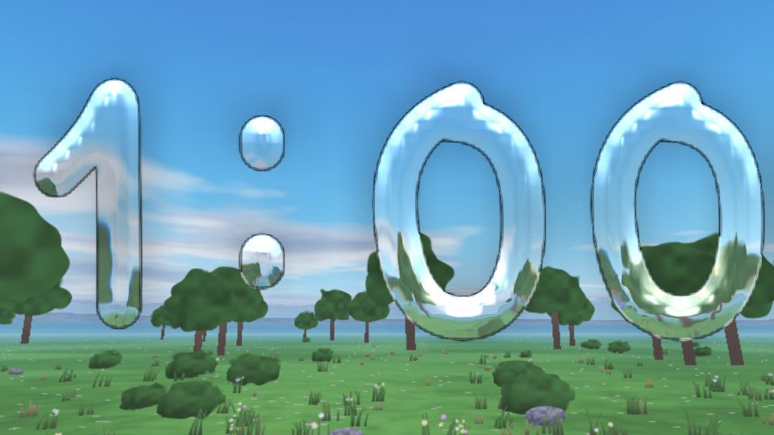 The glass clock by day | 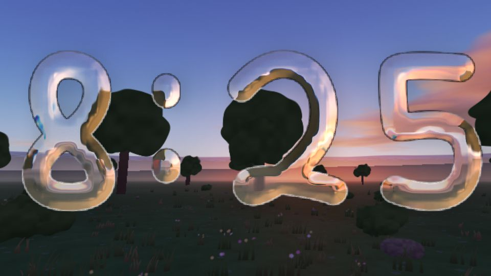 Dusk |
| 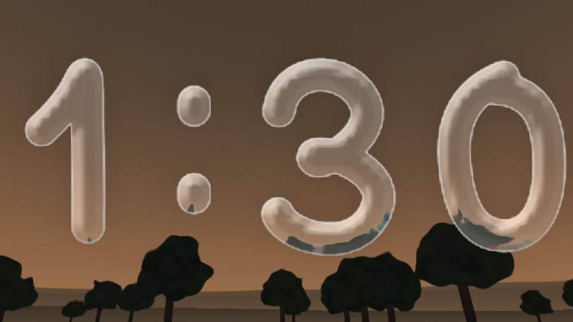 Night | 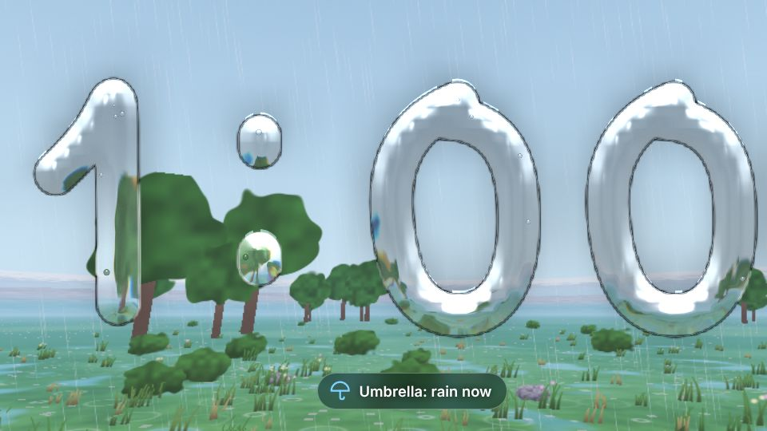 Rain, with the umbrella alert on |
| 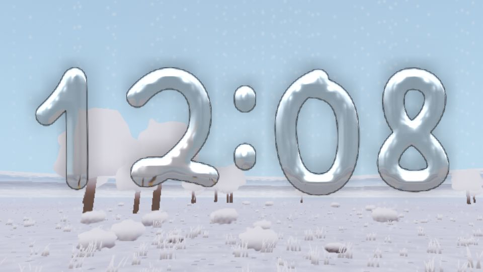 Snow | 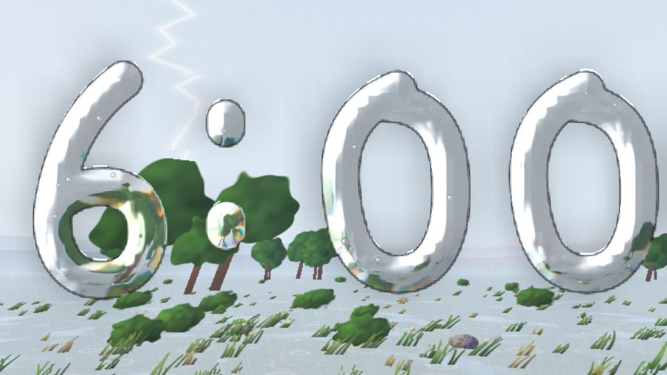 A thunderstorm |
| 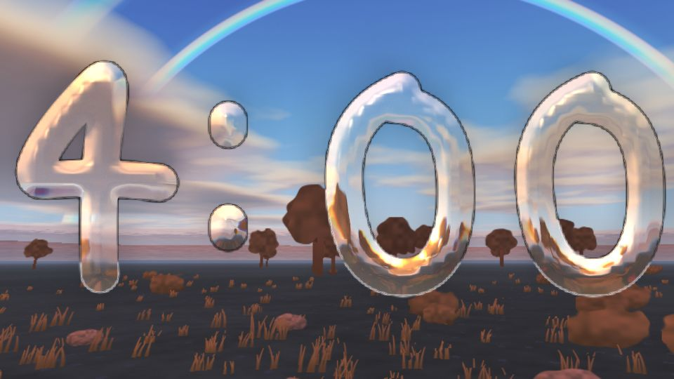 A rainbow (sun low and out, rain in the air) | 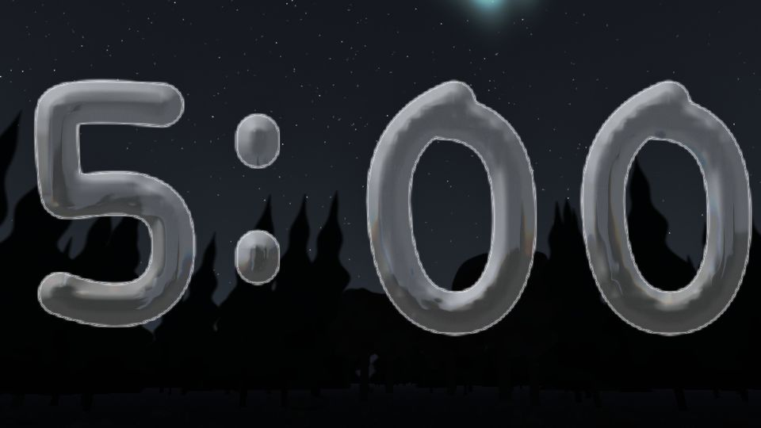 An aurora, from the place's magnetic latitude and the planetary K index |
| 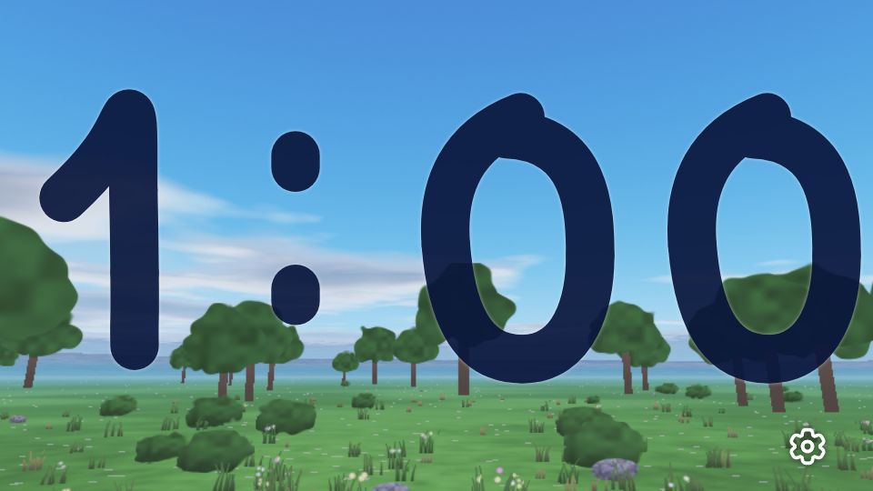 Solid digits | 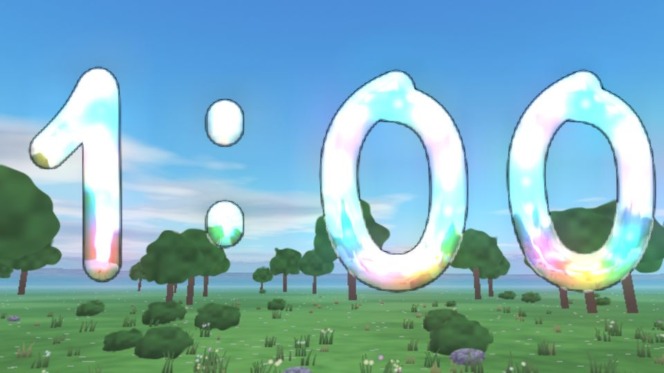 Stained glass |
| 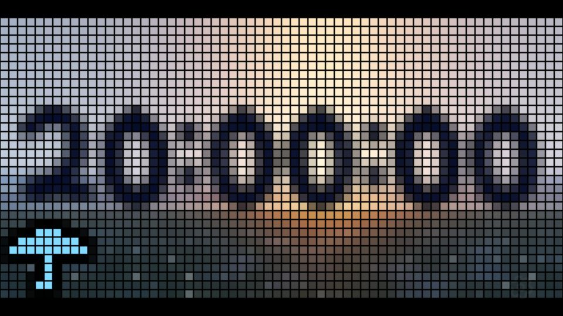 A 64 x 32 LED panel (the countdown and the umbrella are whole LEDs) | 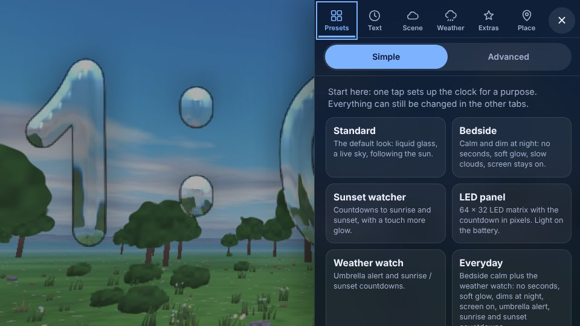 Settings |

With thanks to
[Bézier Clock](http://jackf.net/bezier-clock/) in [VanillaJS](http://vanilla-js.com) with some [easing options](http://www.robertpenner.com/easing/)

## What you get

| | |
|---|---|
| **Atmosphere** | Rayleigh + Mie + ozone scattering with multiple scattering and the planet's shadow, so the orange glow, the rising Earth shadow, the purple afterglow and dusk all come from physics, not from shifting the time. |
| **Night** | 25 k stars (to magnitude 7.5) with colour, atmospheric extinction and a limiting-magnitude model, so stars fade in brightest first as the sky darkens; Milky Way; airglow; light pollution (Bortle scale, estimated from your time zone or set by hand); moonlight scattering. |
| **Sun, moon, planets** | [astronomy-engine](https://github.com/cosinekitty/astronomy) positions for your location and time. Moon texture, phase, libration and earthshine. Sun and moon are drawn a little enlarged by default (a real 0.5° disc is tiny on a phone); there is a "Realistic" setting. |
| **Weather** | Live from [Open-Meteo](https://open-meteo.com/): per-layer cloud cover, rain/snow, fog and visibility, wind (clouds drift at the real speed), aerosols (haze and smoke whiten the sky). Clouds are lit by the actual sunset colour. Or pick a preset (clear, partly, overcast, rain, storm, snow, fog, smoky haze). |
| **Landscape** | "Real terrain around my location" samples a public elevation model in 32 directions out to 40 km and builds your actual skyline, so the sun really does set behind the hills to your west. Or choose flat, hills, mountains, desert, ocean (with sun glitter) or a city with lit windows. |
| **Ocean waves** | Two wave trains (wind sea and swell), each five components from the peak wavelength down to chop, with real deep-water dispersion. Height, period and direction come from Open-Meteo's marine forecast where it covers your spot (a live status line shows e.g. "2.6 m waves every 10 s"), otherwise the sea grows from the live wind speed. The glitter path widens as the sea roughens, whitecaps and wind-blown foam streaks appear from about a fresh breeze, rain dimples the surface with rings, and far swell lifts and drops the horizon. Calm weather gives glass. |
| **Plants & ground** | Grass, wildflowers, shrubs, broadleaf and conifer trees, palms, cacti, acacia and rocks, chosen to suit the place. One satellite tile around your location (Sentinel-2) is classified into forest / grassland / steppe / desert / tundra / urban / snow / water, then region rules pick species (cacti only in the Americas, acacia in Africa and Australia, palms in the tropics) and the date picks the season (spring green, autumn orange, bare winter). Wind sways them at the real wind speed, rain darkens and bows them, wets the ground with puddle sheen and ripples, and snow settles on them. Falls back to latitude rules offline; Settings → Weather & landscape turns it off. |
| **Presets** | The first tab of Settings (every visit starts there): Standard, Bedside, Sunset watcher, LED panel, Weather watch, Everyday (bedside calm + weather watch), Everyday power saver (that as an LED panel with every battery-saver setting), Showcase and Battery saver. No preset touches the sun / moon / planet labels, which are an Advanced debugging aid. A preset is just a set of settings; applying one sets the controls and fires their events, so the other tabs follow, and the card of the preset in use is ticked. "Reset all settings" puts everything back (your location is kept). |
| **Brightness** | Settings → Extras → Brightness: a **day** level and a **night** level (10 to 100%, 100% = no veil), with **sunset and sunrise as the transition**: the screen eases from one to the other over 15 minutes to 2 hours (45 by default) centred on the event, on a smooth curve. A black veil over the page, so on OLED screens it also saves power. Where the sun never sets or rises the sun's height decides. Follows time travel. (This replaced "Dim the screen" and "How dark"; saved settings are migrated.) Pure logic in `js/sky/dim.js`. |
| **Install as an app** | A web app manifest, icons (made by `tools/make-icons.mjs`) and the service worker, which now stores every file on the first visit, so it opens full screen from the home screen and works offline. Chrome / Edge / Android offer an Install button in Settings → Presets; on iPhone and iPad it shows the Share → Add to Home Screen steps. On an iPhone or iPad, where Safari has no install prompt, the Install button opens a three-step walkthrough (Share, Add to Home Screen, Add). |
| **Defaults** | Out of the box: 24-hour or 12-hour time as the browser's locale does it (until you choose), temperature in °C or °F by region (until you choose), screen kept on, look-around view that follows the sun, and glass light that follows the sun or moon. A **return to default view** button sits beside the settings gear whenever the gear is showing: it undoes dragging and zooming and leaves VR. |
| **First visit** | One question: use your real location, or estimate it from the time zone. A real location stays on the device; weather and terrain services only get a rounded position (about 10 km for weather, 5 km for terrain), unless you turn that off in Settings → Place & time → Advanced. |
| **Weather history** | With time travel on and weather set to Live, the weather is that of the chosen moment: recorded for the past (Open-Meteo forecast service for the last ~3 months, its ERA5 archive before that, which has no visibility), forecast for the next two weeks. |
| **Seasons from the weather** | Plants follow the last month's temperature (mean of the last 15 days against the 15 before), not just the calendar: a warm spell in March leafs out early, an early frost brings winter, rising temperatures mean spring and falling ones autumn. Tropics ignore it. Uses the same date as time travel. |
| **Light pollution** | Estimated from the settlements around you (OpenStreetMap towns and cities with their population, summed with Walker's law and mapped to the Bortle scale; standing in a built-up area on the satellite tile counts as at least Bortle 7), instead of one number for the whole time zone. Falls back to the time-zone estimate when the lookup fails. |
| **Christmas** | From US Thanksgiving (fourth Thursday of November) to Christmas Day, by the date the clock shows: a lit Christmas tree stands in the scene (twinkling bulbs, a star; towards where the sun is at noon, a little to one side), and when it is on the sea it floats on a small raft, bobs, and is reflected in the water. While the clock style is left on Automatic it switches from liquid glass to the coloured-lights tube for the season. Turn the tree off in Settings → Scene; choosing a clock style yourself always wins. |
| **Umbrella alert** | Off by default (Settings → Weather → Rain & snow). Reads the hourly forecast for the rest of the day (until 11 pm local): an umbrella when at least 1 mm (0.04 in) is likely, in hours of 0.2 mm or more and at least 30% chance; a yellow umbrella with drops (slicker) at 8 mm (0.3 in) or more, or any single hour of 2.5 mm or more. Says when ("Umbrella: rain, 3 PM to 6 PM · 0.13 in"). Follows time travel; with a manual weather it follows the preset. On the LED panel it is a pixel umbrella in the bottom left corner. |
| **Settings** | A side drawer on wide screens (the sky stays visible beside it) and a bottom sheet on phones with the tabs along the thumb edge. Six tabs (Presets, Clock, Scene, Weather, Extras, Place) in the header, and a **Simple / Advanced** switch under them (along the bottom edge on a phone): Simple shows the common settings; Advanced adds the rest, drawn in amber with an "Advanced" tag so it is obvious which is which. While you drag a slider on a phone the sheet fades so you can see the effect. Dark glass by default, light when the device asks for it. |
| **VR look-around** | Tap the goggles button on a phone/tablet: the sky follows the device's orientation sensors. Drag to fine-tune the compass direction, pinch to zoom. "Look around" mode (drag and pinch, no sensors) works on desktop. Optional labels for the sun, moon and planets with arrows to find them. |
| **Framing** | By default the camera tilts so the horizon sits exactly on the bottom of the clock digits, on any screen size, so the ground always shows beneath them. Untick it in Settings → Scene → Camera to set the tilt yourself. |
| **Keep screen on** | Settings → Extras uses the Screen Wake Lock API so the phone doesn't dim or lock while the page is open (bedside / travel clock). It is released when the page is hidden and re-acquired when it returns. iOS only allows it after a touch, so a "Tap to keep the screen on" banner appears until you tap. Two mechanisms run: the Wake Lock API and a hidden silent video (a real 256x144 clip behind the sky; Chrome ignores tiny ones). On iPhones both run together because Safari can grant a lock and still sleep. Settings shows which is active. |
| **Time travel** | Settings → Time travel: jump to any date/time or run at up to 1 hour per second. |
| **Clock** | The same wobbly morphing digits, in three styles: **Liquid glass** (default: bevelled glass that refracts the real sky behind it, catches the actual sun or moon as glints and a bright rim, and casts a soft shadow), **Coloured tube** (a glass tube with LEDs inside) and the classic **solid ink**, which flips between light and dark so it stays readable. A **Frosting** slider takes the glass from perfectly clear to fully etched, and **Light from inside** makes the glass glow (a lamp in the thick middle of each stroke, a halo on the sky, in warm / white / cool or the colour of the sun or moon). **Coloured tube** is a plain glass tube lit by LEDs inside, like a tube light: no lines on the outside, just evenly spaced lights of varying colours. Each digit is treated as one line (its curves end to end) with the same number of lights at fixed fractions of its length, so laid flat they would be evenly spaced, and as the digit stretches and bends each light stays at its place along the line. |
| **Always readable** | Settings → Text → "Keep the time readable" (on by default). The edge of every digit gets a thin outline that is near-black where the sky behind it is bright and near-white where it is dark, so it beats the sky by at least about 3.8:1 whatever the sky is; the colour follows the sky smoothly, so where a horizon crosses a digit the top edge is dark and the bottom edge light, and the glass itself stays glass (the body is only eased a little darker under a bright sky and lighter under a dark one). Judged by brightness, not colour, so it works for colour-blind eyes. "Extra strong" thickens the effect, "Off" is pure glass. Solid ink picks light or dark by worst-case contrast and gets a halo of the opposite tone. |
| **Sunrise & sunset countdown** | Settings → Extras. Starting 10 to 30 minutes (20 by default) before the sun reaches the horizon, a pill counts down to it ("Sunset in 04:09"), then says "Sunset" for a minute. Sunrise, sunset or both. Times are the almanac ones (upper limb, standard refraction) so real hills hide the sun slightly earlier. Follows time travel. In Advanced it can instead count down to golden hour, civil, nautical or astronomical twilight (dawn and dusk), or moonrise and moonset. |
| **Follow the sun** | Settings → Scene → Where you look (clock view only). Only the compass direction moves, never the tilt, so the sun stays at one height while it crosses the screen from the right quarter at sunrise to the left quarter at sunset, in either hemisphere, like east to west on a map. The position comes from the sun's real azimuth, so the seasons show: in June the sun rises further round to the north and starts nearer the right edge, in December nearer the middle. Overnight the view turns back, slowly, to the next sunrise. |
| **LED panel** | Settings → Extras (Advanced). The whole picture becomes a grid of square LEDs with black lines between them, the clock as lit pixels. You choose how many LEDs across and down (8 to 256 each; presets for 64 × 32, 32 × 64, 96 × 48, 128 × 64, 64 × 64, 128 × 32, 32 × 32, 32 × 16 and 16 × 16), and the panel turns on its side by itself when the screen is the other way round (switch off with "Turn to match the screen"). The classic 64 × 32 / 32 × 64 panel has a hand-tuned layout: the digits are packed to fit the panel and, on a tall one, stacked two to a row, and the countdown and umbrella are drawn in a pixel font on whole LEDs. Other sizes use the same tuned layout wherever it works (at least 32 × 24 LEDs, no more than 4 times longer than high; it picks digits in a row or stacked, whichever gives taller digits); anything outside that (for example 32 × 16 or 16 × 16) is shown exactly like the normal page, with its normal countdown pill, just turned into LEDs. LEDs are never drawn smaller than 3 pixels: if the count is too high for the screen the grid is reduced, keeping its shape. |

## Loading

A cached start is not instant: the page still has to parse about 25 scripts, build the WebGL programs and draw the first frame. Measured with everything served from the service worker's cache and the CPU slowed 4 to 6 times (a rough phone), the scripts are running after about 0.6 to 0.8 s and the first frame is submitted after about 0.8 to 1.1 s; the GPU's own share (shader build, the atmosphere tables) could not be measured without a real device. What is done about it:

- **The last sky is shown at once.** Once a minute (and when you leave the page) a tiny picture of the sky, without the clock, is saved (about 1.3 KB). On the next launch it is painted behind the loading screen by the first inline script, so the sky is there as soon as the page paints and the real one fades in over it. Only if it is under 4 hours old, else the colours of the last sky are used.
- **Only the sky is on the critical path.** The settings panel, presets and dimming are wired after the first frame is on screen (`app.js`), the digits are hidden until drawn once, and all scripts and data are preloaded in parallel.
- **Shaders build in parallel.** All programs are created up front and only checked when first used, with `KHR_parallel_shader_compile` on, so the driver builds them side by side while the page carries on.
- **The service worker** keeps one open cache handle instead of opening it for every request.
- Marks for the timeline are in the page (`performance.getEntriesByType('mark')`; add `?perf` to wait for the GPU): `app:init`, `sky:engine-created`, `sky:first-render-start/end`, `sky:assets-done`, `app:setup-done`, `app:ready`.

Not done: bundling the scripts into one file would save the per-file service-worker round trips and some parse time, but it needs a build step, which this project avoids.

## Offline

After one visit with a connection the whole app is stored on the device (`sw.js` saves every script, the star catalogue, Milky Way and moon textures, and the icons), so it opens and runs with no connection at all, in a browser tab or installed. Settings → Presets → Offline says how much is saved. What keeps working offline: the clock, the sun, moon, planets and stars (computed on the device), the sky and landscape, glass and LED looks, presets, countdowns, time travel, your GPS or time-zone location. What needs a connection and how it behaves without one:

- **Weather, sea state, rain forecast:** the last saved values for your place are used however old (the status line says how old, for example "saved 5 h ago, refreshes when a connection is back"); with nothing saved the sky is clear.
- **Terrain, land cover, light pollution, weather history, seasons:** saved for good (or for 30 days) after the first successful look-up, so places you have been are complete offline; a new place falls back to a procedural landscape and the time-zone light pollution estimate until it can look it up.
- **When the connection returns** (the browser's `online` event) everything that failed is fetched at once, and a lookup that failed while online is retried every minute.

Limits: the first visit must be online; Safari may clear a web page's stored data after a week of not opening it, though an app added to the Home Screen is exempt.

## Waking up as little as possible

For an always-on clock the idle cost matters. Eleven independent `setInterval`s became one scheduler (`scheduler.js`): each job has a period that can be a function and returns Infinity while it has nothing to do (labels off, no countdown, rain alert off, no time travel...), a single timeout sleeps until the next job is due (capped at 5 s so a changed setting is noticed), and nothing runs while the page is hidden. The sky's render loop sleeps on a timer between redraws instead of asking for 60 animation frames a second, and wakes at once when anything marks the scene dirty; the clock's loop ticks only while a digit is morphing, then sleeps until the next second. Measured in a headless browser with a still sky and hidden seconds, wake-ups fell from about 80 a second to about 6.

## Why it is fast

The previous version ran a nested raymarch (about 2000 exponentials) for every pixel on every
frame, and ignored the planet's shadow and the sun's azimuth, which is why sunsets failed and
had to be faked by shifting the time. It now follows
[Hillaire 2020](https://sebh.github.io/publications/egsr2020.pdf):

1. **Look-up tables** for transmittance, multiple scattering and the sky dome are computed on the
   GPU only when the sun or moon has actually moved (about every 10 s at sunset).
2. A **frame** is then one texture lookup per pixel for the sky, plus the sun, moon, stars, clouds
   and terrain.
3. **Throttled drawing**: a still sky redraws about once a second, an animated one (moving clouds,
   water) about 15 fps (8 on Low quality), and look-around modes run at the display rate. Hidden
   tabs do no work, and `prefers-reduced-motion` stops the animation.
4. **Dynamic resolution** ("Automatic" quality) lowers the render scale if frames run long.
5. The clock no longer re-measures the layout on every animation frame (a `MutationObserver` on the
   digits' `d` attribute was doing exactly that).

Measured in a headless browser on a CPU rasterizer (same machine, same 1280×720 canvas; a phone
GPU is orders of magnitude faster, so read the ratio, not the milliseconds): the old shader took
about **9,950 ms per frame**, the new sky **about 500 ms at full resolution and 290 ms at 0.75
scale** with clouds, terrain and stars, and the old shader had to do that every frame.

## Running it

No build step. Serve the folder with any static server (ES modules and `fetch` need http, not
`file://`):

    python3 -m http.server 8000

Everything is static; deploy by pushing to GitHub Pages.

Requirements: WebGL2 with floating-point render targets (all current phones and desktops). Without
it you get a plain sky-coloured gradient and a note in Settings.

### If VR look-around is off on an iPhone or iPad

iOS reports the compass differently from Android, and what it does once the device is held upright in landscape is not
documented. The code estimates the compass offset from the raw sensor angles (it used to feed its own correction back in,
which made the view spin), tracks both plausible readings of the heading and uses portrait / landscape to pick when
turning alone cannot tell them apart. If the sky is still 90° out, Settings → Scene → Advanced → Motion sensor fixes lets
you choose the compass reference or ignore the screen rotation, and "Show sensor readout" prints the raw numbers.

### Developer deep links

These are not saved to your settings:

    ?t=2026-06-21T20:30:00Z          pin the date/time (UTC)
    &speed=60                        ...and run at 60x
    &lat=40.7&lon=-74                location
    &az=280&pitch=10                 view direction
    &weather=storm                   clear|partly|cloudy|overcast|rain|storm|snow|fog|haze|live
    &landscape=ocean                 auto|flat|hills|mountains|desert|ocean|city
    &lp=1                            light pollution: off, or Bortle 1-9
    &waves=2.5x9                     force the sea state: wave height m x period s (ocean landscape)
    &xmas=1                          force the Christmas tree on (0 forces it off)
    &biome=conifer                   force land cover: grass|forest|conifer|tropical|steppe|desert|tundra|urban|snow

`window.__sky` exposes the engine in the console.

## Layout

    index.html, styles.css            page, settings, VR button
    js/clock.js, easing.js            the wobbly clock (unchanged look)
    js/sky/engine.js                  GL pipeline, scheduler, adaptive resolution
    js/sky/glsl-atmosphere.js         transmittance / multiple scattering / sky-view LUTs
    js/sky/glsl-scene.js              composite, stars, clouds, terrain, tone mapping, glass / stained glass
    js/sky/astro.js                   sun / moon / planets / sky rotation (astronomy-engine)
    js/sky/weather.js                 Open-Meteo + presets
    js/sky/landscape.js               procedural skylines + real-terrain skyline
    js/sky/biome.js, plants.js        land cover from a satellite tile, season, palette; plant placement
    js/sky/glsl-plants.js             instanced plant sprites with wind
    js/sky/glass.js                   rasterises the digits for the glass styles; light direction from sun/moon
    js/sky/controls.js                drag / pinch / VR sensors
    js/sky/orientation.js             device orientation maths and the iOS compass calibration (testable in node)
    js/sky/lightpollution.js          light pollution from nearby settlements (Walker's law)
    js/units.js                       regional defaults: 12/24 h, °C / °F
    js/season.js                      the Christmas season (Thanksgiving to Dec 25)
    js/sky/rain.js                    umbrella / slicker from the hourly forecast
    js/sky/sunpath.js                 sunrise / sunset times, the countdown, the follow-the-sun camera
    js/sky/app.js                     creates the engine, wires the modules below, registers the periodic jobs
    js/sky/core.js                    shared state (engine / controls / glass are live bindings), small helpers
    js/sky/data.js                    location, live + historical weather, landscape, plants, tree, quality, time travel
    js/sky/view.js                    camera: clock view, look-around, VR, follow-the-sun, labels, return-to-default
    js/sky/appearance.js              loading screen, no-WebGL fallback, clock ink colour, favicon
    js/sky/alerts.js, ledcard.js      countdown and umbrella pills; the LED panel's pixel overlay (or full-size pills on untuned sizes)
    js/sky/ledgrid.js, ledpanel.js    LED panel size, turning, tuned layout or fit (pure maths + page glue)
    js/sky/bindings.js, presets.js    settings controls; presets and reset
    js/sky/dim.js                     night dimming
    js/sky/scheduler.js               the one timer for periodic work (a period of Infinity = nothing to do)
    data/                             star catalogue, Milky Way, moon map (built by tools/build-data.py)
    tools/                            data builder (build-data.py), icon maker (make-icons.mjs)
    tests/                            unit and browser tests, the test harness, picture baselines (see Testing)
    .github/workflows/ci.yml          lint, unit tests and browser tests on every push

## Testing

    npm ci                                  once: installs the linter and Playwright (npx playwright install chromium for the browser)
    npm test                                the everyday check: lint, the unit tests and only the browser suites your changed files can affect, each trimmed to its core (about 40 s for a typical change)
    npm run test:quick                      lint, unit tests and the core of every main browser suite (about 3 minutes)
    npm run test:full                       everything, as CI runs it (about 10 minutes on one machine)
    npm run lint                            real mistakes only: undefined names, unused variables
    node tests/run.mjs unit                 13 suites in about 3 s, no browser
    node tests/run.mjs browser [name]       the real page in headless Chromium (software WebGL), a few minutes
    npm run test:visual:update              redraw the picture baselines (tests/visual/baseline) after a deliberate visual change

**Unit tests** (`tests/unit`) cover the pure logic: sun path and follow-the-sun, orientation and compass calibration, weather and seasons, rain rules, light pollution, LED grid maths, the Christmas dates, saved settings and their one-time migration, presets, night dimming, the scheduler, and `static.test` (every element id a script looks up exists in the page, every `conf.x` is a defined setting, every drop-down offers its default, no stray `console.log`, the PWA files are complete). `tests/lib/dom-stub.mjs` gives node just enough of a browser to import modules that touch the page.

**Automatic digit style:** liquid glass, coloured lights from Thanksgiving to Christmas, and flat colour whenever the device is saving power (Low quality, or, where the browser reports a battery — Chrome and Android, not Safari — under 20% and unplugged). Safari does not expose iOS Low Power Mode, so there the Low quality setting is the switch.

**Countdown mode** (Settings → Text → The digits show: A countdown to a date; Advanced): the same morphing digits show days:hours:minutes:seconds to a date and time you pick (your own time zone) with an optional name; everything else works as before (it follows time travel too). The digits are capped at 6 with the seconds shown and 4 with them hidden, so the biggest units that fit are shown: under a day `H:MM:SS` (seconds hidden `H:MM`); a day or more `D:HH:MM` (seconds hidden `D:HH`; the seconds do not fit); 100 days or more `DDD:HH` (seconds hidden `DDD`). The first number has no leading zero. A caption names the units ("days:hours:minutes"), and the tab title shows the countdown. When the date arrives the digits show `00:00` for the rest of that day (caption "today"); after midnight the clock goes back to showing the time and the setting returns to "The time" by itself (not while time travel is on). Pure logic in `js/countdown.js`; a hundreds-of-days digit is the extra `#hundredsDigit` svg.

**Known gaps and ideas** are in `TODO.md` (first up: raindrops on the digits should run down and follow a changing digit).

**Stars on the LED panel** (Settings → Extras → Advanced → Stars on the LED panel: Automatic / Always / Off): a star is far smaller than an LED, so averaging the picture over each LED's block loses it. A small extra pass (`FRAG_LED_PEAK`) finds, per LED, the brightest pixel of its block and how far it stands above the block's average, skipping the blocks the digits are on; the LED shader then lights that LED, only where the sky is dark, and only the brightest in each 3 x 3 neighbourhood (so they read as stars, not noise). Because it is derived from the normal picture, a star shows on the panel exactly when it shows in the normal picture (none by day, fewer under city light), and the moon and planets come along. "Always" lowers the threshold and brightens them.

**Pills and the digits:** the pills (rain alert, sunrise / sunset countdown, countdown name) sit at the bottom: upright, a row above the corner buttons; in landscape, side by side in the row of the corner buttons. `js/sky/pillroom.js` measures the bottom of the digits against the top of the pills and, only if they would touch (wide screens, seconds hidden), makes the clock's box shorter by just what is needed (`--pill-room`), which scales the digits down a little. It works for any aspect ratio and either seconds setting; where there is room (upright phones) nothing moves.

**Version:** Settings → Presets → About shows the version of the copy that is running ("Version 7 (8e5baf69), built 2026-11-01") and asks the server what the newest is ("you are up to date" or "the server has a newer version: 9"). The number goes up and the hash changes whenever any file of the app changes; `js/version.js` is generated by `tools/stamp.mjs` (`npm run stamp`, which `npm test` runs first), loaded as a plain script by the page and by the service worker, which names its cache after it. A unit test fails if the stamp is stale, so CI refuses a commit that forgot it. In the console: `__version`.

**Updating an installed app:** an installed app has no reload button, and it opens from the saved copy while fetching the new one in the background, so a new version normally arrives one launch after it is published. When the service worker sees that a file on the server is different from the saved one it tells the page, which shows a "A new version is ready: tap to update" banner at the top (it never reloads by itself, so a clock left running is not interrupted). Settings → Presets → Offline → **Update and reload** fetches every file again now and restarts the page (it asks the service worker to re-fetch the whole precache, `sw.js` message `refresh`). Remember to bump `VERSION` in `sw.js` when the list of files changes.

**Anti burn-in:** while "Keep the screen on" is on (Settings → Extras → Advanced → Anti burn-in: Automatic / Always / Never) the digits and pills step a few pixels (3 to 10, never more than half the room to the edge, whole LEDs in the LED look) round a small square, one step a minute, timed with the minute digit changing (`js/sky/burnin.js`).

**Saving power on the sea:** when the device is saving power the sea (the only thing that animates in a still scene) redraws once a second, just after the second turns, instead of 8–15 times a second, so it costs about what a still scene does.

**Wind sway** (Settings → Weather → Wind, Advanced, off by default): the digits lean downwind like palm trees, the bottoms fixed and the tops moved, so a glance shows the rough strength and direction. The wind is the one the sky is drawn with (live, forecast or recorded, or the manual weather's). The lean is the part of the wind across the screen, so it follows the way you look; head-on wind only gusts. Each digit's control points are bent (`js/wind.js`, `js/clock.js`), so it works in every style, LED included. The lean is capped at about 12° of slope (15° with a full gust) so the time stays readable. "Lean" is steady and costs nothing; "Lean and gusts" redraws the digits 15 times a second (about 15 timer wake-ups a second instead of 3), and is switched off while saving power or with reduced motion.

**Repository layout and the native version.** Web page at the root (`index.html`, `js/`, `styles.css`, `sw.js`); the **settings schema** in `schema/` (`settings.js`, `presets.js`, and the generated `settings.json`: one list of every setting that the page's defaults, the presets, the settings-panel tests and the native version all read; `npm run schema` regenerates the JSON, a unit test fails if it is stale, and the options test checks every control in the page against it); `tools/`, `tests/`, `docs/`; and `native/` for the coming Raspberry Pi version (see `native/README.md` for what the two halves share and the rule that a shared change changes both).

**Share links** (Settings → Presets → Share this setup): the current setup as a link that opens the clock exactly like this on a screen nobody can touch (a digital sign, a kiosk browser), in two forms that decode to the same setup. The **short** form (`?c=...`) is bit-packed (`js/share.js`): the closest preset plus the settings that differ, 7 bits for a setting's number and 1 to 7 for its value, then an optional place; a preset alone is 3 characters, a preset and five changes about 12, with a place about 8 more. The **readable** form (`?v=1&preset=bedside&hideSeconds=on&place=41.88,-87.63&kiosk=1`) uses the real names, for a person to read and edit. Both are **applied for that load only and never saved** (a shared setup never overwrites anyone's own settings), a link that carries a place (or none) never shows the first-run location question, and the **Kiosk** switch hides every control and banner, fixes the view, and makes the page reload by itself when a newer version is found (in the quiet hour, 3 at night by the screen's own clock: `js/quiet.js`). The version-1 settings table and presets are **frozen** (new settings are only appended in a new version), and golden links in `tests/unit/share.test.mjs` must keep decoding to the same setups.

Also in the Share box: a **QR code** of either link (`js/qr.js`, a small encoder for versions 1 to 40, so any link up to 2331 characters has a code; its golden codes were decoded with an independent decoder (every version at both error-correction levels was decoded with OpenCV when it was extended)), a **length limit** check for a sign that restricts the address, a box that **converts a pasted link** into the other form and says in words what it does, and friendlier names in readable links (`weather=rain`, `style=solid`, `night=0.3`, `seconds=off`, `led=on`, `sign=1`, `timezone=Asia/Tokyo`; only read, never written). A link opened on an **ordinary screen** shows a banner: **Use this setup** (saves it on this device and goes to the plain address) or **Just look** (nothing is kept). **Version 2** of the link adds one optional field, a **time zone**, so a sign in one city can show another's time (`Settings → Place → Show the time in another time zone`, filled in by a place search; `js/timezone.js`); a link without one is still written as version 1. **Version 3** links carry a place picked from that list as the city's number (8 bits instead of 45) and bring its time zone with it, so a link for Chicago is about 19 characters shorter than one with coordinates and a zone name; the list's first 128 entries are **frozen** (a test pins them; new cities are only appended) and a place that is not that city (another name, more than 0.2 degree away, or a different zone chosen) is still sent as coordinates, so nothing is changed silently. A person can also write `?preset=bedside&city=Chicago`. Place search falls back to a **built-in list of about 130 large cities** (`js/cities.js`) when the online service cannot be reached.

**The native (Raspberry Pi) version:** `native/cli/` is the command line, tested without a Pi (`wobbly-clock setup | test | get | set | preset | apply | import-matrix-cfg | install-service`, man pages generated from the schema); the renderer is not built yet. See `native/README.md` and `docs/LED-PANELS.md`.

**Set the place myself** (Settings → Place): type latitude and longitude (validated, decimal comma accepted) or search by name (the free Open-Meteo place search, only when you type); the place is kept, never replaced by the GPS or the time-zone estimate, never questioned, and travels in share links.

**Raindrops are a simulation** (`js/sky/drops.js`): drops form on the digits' glass, grow while it rains, and past a size run down in jerky bursts (sticking, then slipping, faster the bigger they are) leaving a wet trail, swallowing the smaller drops they meet; a drop that runs off the bottom of a stroke hangs for a moment and falls; when the digits move or change and the glass is no longer under a drop, the drop is shed. The simulation runs on the CPU in the mask's own pixels (a seeded generator, so tests are repeatable), is drawn into a canvas the size of the glass mask with three channels (dark rim, glint, water) and read by the glass shader; with the effect off, or if it cannot run, the older stateless beads are the fallback. **Rain and snow on the digits** (Settings → Weather → Rain & snow, Advanced, on by default): in the liquid glass, coloured tube and LED styles, snow settles on the upper edges of the digits as a lumpy cap (thicker in heavier snow, at most about 30% of the stroke), rain beads up on the glass (small lenses that show the sky bent, with a darker rim and a glint; some slide down leaving a thin wet trail) and drops splash off the top edges. It is drawn in the glass shader (`FRAG_BLIT`) before the readability outline, so every digit keeps its outline, and only where there is ink or just above it. It follows the weather being drawn (live, recorded, forecast or manual) and moves with the scene's own animation, so it adds no extra redraws; while saving power it steps once a second with the sea. Flat colour (Solid) is left plain. Since then: a drop that loses its glass because a digit changed is **thrown off** away from the glass that is left (and sticks if it lands on other glass), a running drop **follows water already on the glass** (faster and drifting towards an earlier drop's track; the water dries in a few seconds), leaves **small beads** behind it, and merging keeps momentum. The picture of the drops, like the glass mask, is drawn by the GPU (`js/sky/glsl-mask.js`); only the simulation, a few hundred numbers a frame, runs in JavaScript.

**Browser tests** (`tests/browser`) start a static server and one Chromium, give each test a fresh page with the weather, terrain and town look-ups mocked (so they are fast, offline and repeatable), and use `?t=` (time travel) or a frozen page clock to pin the date. They check: startup and the loading screen; 12/24-hour by locale; the sky (day bright and blue, night dark, twilight warm at the horizon, a storm is grey); every settings-panel behaviour on a phone and a wide screen; the first-run question and the upgrade of old saved settings; the countdown and umbrella pills and the LED card (including that nothing covers the time); the LED panel for eight sizes (grid, layout, nothing cropped, centred, black lines between LEDs, black bezel) and its size controls; the Christmas season by date and the tree on land and at sea; the service worker, offline opening, saved weather and catching up when the connection returns; the idle wake-up budget; **performance standards** (`tests/browser/perf.test.mjs`: first-visit download size and request count, how soon the page starts and the loading screen goes, no long blocks of main-thread work, a still sky drawing about once a second and an animated one never above 15 fps, no heap growth over 20 s of fast time travel; `tests/unit/weight.test.mjs`: size of the offline download, the page's own scripts and the largest file; budgets sit at the top of each file and are 2.5–4× what a slow software-rendered machine measures, so they flag a several-fold regression, not noise; `PERF=print` lists every measurement); where settings live (Simple / Advanced), anti burn-in, wind sway, rain and snow on the digits, the iPhone install walkthrough and the Everyday presets; and seven pictures compared with baselines. In CI the browser suites run in three shares side by side (`SHARD=2/3 node tests/run.mjs browser`), so the whole run takes the time of the slowest third; the suites are dealt to the shares by measured cost (about 6 minutes each as of 2026-11-04). **What is tested and where the time goes** is in [`docs/TESTS.md`](docs/TESTS.md) (generated from a CI run by `tools/tests-report.mjs`).

**How `npm test` stays fast.** A browser test costs about 3 s a page (the first sky picture is a heavy software-WebGL computation, and the four cores are already busy with it, so running suites side by side does not help). So `npm test` (`node tests/run.mjs changed`) asks git which files changed and `tests/impact.mjs` which suites they can break, and runs only those, always with the smoke page, each suite doing just its core (`t.quick`). A change to a core file (the engine, scheduler, config, the test harness) runs the whole quick check. A unit test fails if a file of the app matches no rule, so nothing is silently left untested. What it does not run: the deep suites (Christmas by date, idle wake-ups, performance standards, picture baselines) and the long tails of the quick ones. CI and `npm run test:full` always run everything.

**CI** (`.github/workflows/ci.yml`) runs lint and unit tests, then the browser tests, on every push and pull request, and keeps the screenshots as artifacts. The browser is pinned (Playwright 1.63.0), and the picture baselines drawn on a developer machine matched on GitHub's runner on its first run, so pictures are compared strictly. After a deliberate visual change, redraw them with `npm run test:visual:update`, or run the workflow by hand with `update_baselines` ticked and commit the `visual-baselines` artifact to `tests/visual/baseline/`. `VISUAL=warn` turns picture differences into warnings.

What the tests do not cover: real phones and tablets (the iPad VR fix, install prompts, real GPUs), the live weather, terrain and town services (they are mocked), and a human's judgement of how it looks beyond the seven baselines.

## What is and is not verified

Built and checked in a headless Chromium (software GL): the atmosphere through a full sunset and
night, stars, Milky Way, moon phases, every landscape and weather preset, desktop and phone-sized
layouts, the no-WebGL fallback, time-lapse, drag / zoom, and the VR sensor code path using
synthetic orientation events (plus a unit test of the orientation math against known phone poses).

**Not verified:** behaviour on real phones and tablets (the iPad VR fix described above was reasoned out and unit-tested, not tried on an iPad) (frame rate, motion-sensor feel, iOS compass
calibration, which uses `webkitCompassHeading`), and the live Open-Meteo calls (the build sandbox could not
reach the service; the code was exercised against mocked responses in Open-Meteo's documented
format). If a live call fails, the page quietly keeps clear-sky defaults.

Known limits: the sea is shaded, not modelled geometry, so waves never hide the horizon or tilt the view; marine data covers open water only; plants are procedural sprites (they do not parallax if you move, only if you turn), species choice is a heuristic from one satellite tile plus geography rather than a botanical survey, one cloud layer set per altitude (no volumetric clouds), no lightning, the
sun and moon are slightly enlarged by default, planets Uranus/Neptune and satellites are not drawn,
real-terrain mode samples 3 distances so very distant mountains beyond 40 km are not included.

## Privacy

Your exact position never leaves the device unless you turn "Share only an approximate position" off. Live weather, weather history and the sea state send a position rounded to 0.1° (about 11 km) to Open-Meteo, terrain a position rounded to 0.05° (about 5 km), and the light pollution lookup a position rounded to 0.05° to an Overpass (OpenStreetMap) server. The land-cover satellite tile is fetched by tile number only. Results
are cached in your browser. Choose a manual weather/landscape preset to make no requests.

## Credits

- Atmosphere model: Sébastien Hillaire, *A Scalable and Production Ready Sky and Atmosphere
  Rendering Technique* (EGSR 2020), building on Bruneton & Neyret. Coefficients as published.
  The sky code this project started from was [Horizon](https://github.com/dnlzro/horizon) by
  Daniel Lazaro (MIT, `js/sky/LICENSE-horizon.txt`), itself derived from Andrew Helmer's
  "Production Sky Rendering" (MIT); the medium coefficients and phase functions still follow them.
- [astronomy-engine](https://github.com/cosinekitty/astronomy) by Don Cross (MIT), vendored in `js/vendor`.
- Star catalogue and Milky Way outlines via [d3-celestial](https://github.com/ofrohn/d3-celestial) by Olaf Frohn (BSD-3, see `data/LICENSE-d3-celestial.txt`).
- Moon map: NASA Scientific Visualization Studio, *CGI Moon Kit* (LRO). Please check NASA's media usage guidelines for your use.
- Land-cover tiles: [Sentinel-2 cloudless](https://s2maps.eu) by EOX IT Services GmbH (contains modified Copernicus Sentinel data), CC BY-NC-SA 4.0, so personal / non-commercial use; check the terms before anything else.
- Weather, aerosol and elevation data: [Open-Meteo.com](https://open-meteo.com/) (CC BY 4.0 data; their free API is for non-commercial use, check their terms).
- Time-zone locations and light pollution estimates: [Virgo](https://github.com/mcteamster/virgo).
- [Stellarium Web Engine](https://github.com/Stellarium/stellarium-web-engine) was evaluated and not used as the renderer: it is AGPL-3.0, needs an Emscripten toolchain and streams its star data from remote servers.
- [Hacker News](https://news.ycombinator.com/item?id=44846281) for a great collection of related resources.
